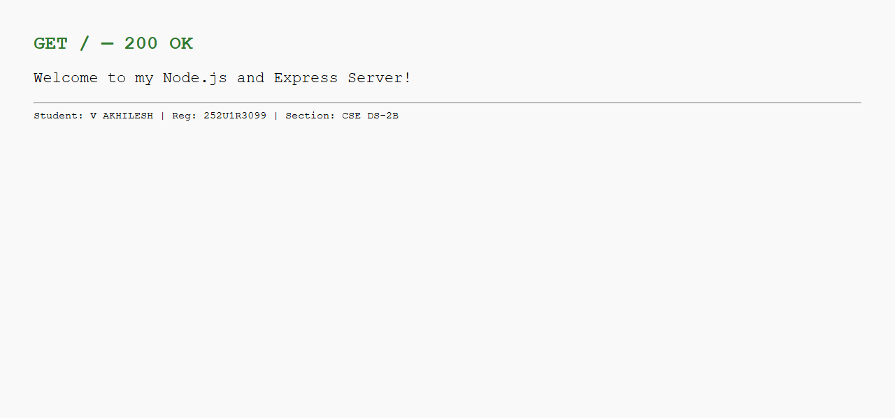
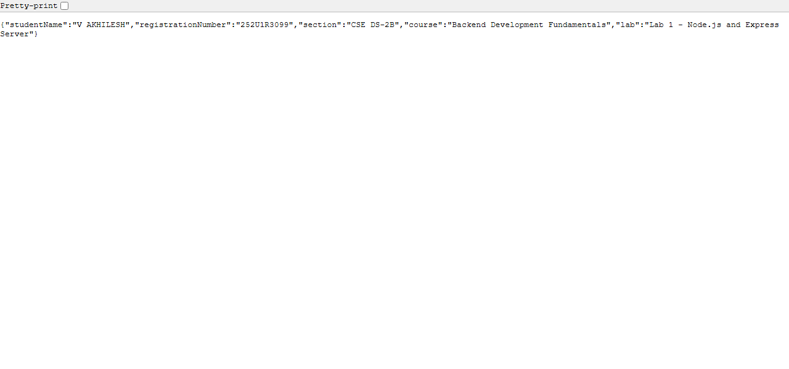
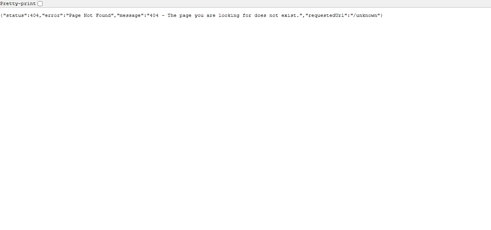

# Lab 1 – Node.js and Express Server

> **Deployment URL:** *(See Phase 10 – Deployment section below)*

---

## Student Details

| Field               | Details                          |
|---------------------|----------------------------------|
| **Student Name**    | V AKHILESH                       |
| **Reg. Number**     | 252U1R3099                       |
| **Section**         | CSE DS-2B                        |
| **Course**          | Backend Development Fundamentals |
| **Lab Number**      | Lab 1                            |
| **Lab Title**       | Node.js and Express Server       |

---

## Project Description

This project is the first lab assignment for the **Backend Development Fundamentals** course. It demonstrates how to:

1. Set up a Node.js project from scratch using `npm init`.
2. Build a basic HTTP server using Node.js's built-in `http` module.
3. Build a more powerful HTTP server using the **Express.js** framework.
4. Define multiple GET routes with appropriate HTTP status codes.
5. Handle unknown routes with a custom 404 error response.

---

## Objectives

- Understand how Node.js handles HTTP requests and responses.
- Learn how Express.js simplifies server creation compared to the raw `http` module.
- Practice creating REST API routes that return plain text and JSON responses.
- Understand `package.json`, `node_modules`, and the npm ecosystem.
- Deploy a Node.js application to a cloud platform.

---

## Technologies Used

| Technology     | Version    | Purpose                              |
|----------------|------------|--------------------------------------|
| Node.js        | v24.15.0   | JavaScript runtime environment       |
| Express.js     | ^4.x       | Web application framework            |
| JavaScript     | ES2020+    | Programming language                 |
| npm            | 11.12.1    | Node Package Manager                 |
| Git            | Latest     | Version control                      |

---

## Project Structure

```
lab-01/
|
+-- basic-server.js      <- Phase 2: Basic HTTP server (built-in http module)
+-- server.js            <- Phase 3 & 4: Express server with all routes
+-- package.json         <- Project metadata and dependencies
+-- package-lock.json    <- Exact dependency versions (auto-generated)
+-- .gitignore           <- Files excluded from Git
+-- README.md            <- This documentation file
|
+-- screenshots/
    +-- home.png         <- GET / response screenshot
    +-- about.png        <- GET /about response screenshot
    +-- time.png         <- GET /time response screenshot
    +-- not-found.png    <- GET /unknown (404) response screenshot
```

---

## Understanding package.json

`package.json` is the configuration file for a Node.js project. Here is what each important field means:

| Field         | Meaning |
|---------------|---------|
| `name`        | The name of your project/package. Used when publishing to npm. |
| `version`     | The version of your project following SemVer (e.g., `1.0.0` means major.minor.patch). |
| `description` | A short description of what your project does. |
| `main`        | The entry point file Node.js will run when your package is imported (here: `server.js`). |
| `scripts`     | Shortcuts for terminal commands. `npm start` runs `node server.js`, `npm run start:basic` runs `node basic-server.js`. |
| `keywords`    | Tags that help people find your package on npmjs.com. |
| `author`      | The developer's name. |
| `license`     | Legal terms for using the code. `ISC` is a permissive open-source license. |

---

## Installation Instructions

### Prerequisites
- [Node.js](https://nodejs.org/) (v18 or above) must be installed.
- Verify with: `node --version` and `npm --version`

### Steps

```bash
# 1. Clone the repository (or navigate to the lab-01 folder)
git clone <your-github-repo-url>
cd lab-01

# 2. Install dependencies
npm install
```

---

## Running the Servers

### Start the Basic HTTP Server (Phase 2)
```bash
node basic-server.js
# OR
npm run start:basic
```
> Visit: http://localhost:3000 - Response: `Hello`

### Start the Express Server (Phase 3 & 4)
```bash
node server.js
# OR
npm start
```
> Visit: http://localhost:3000

---

## API Endpoints

| HTTP Method | Endpoint   | Description                        | Status Code |
|-------------|------------|------------------------------------|-------------|
| GET         | `/`        | Welcome message                    | 200 OK      |
| GET         | `/about`   | Student details in JSON format     | 200 OK      |
| GET         | `/time`    | Current date and time              | 200 OK      |
| GET         | `/*`       | Any unknown URL - 404 Not Found    | 404         |

### Sample Responses

**GET /**
```
Welcome to my Node.js and Express Server!
```

**GET /about**
```json
{
  "studentName": "V AKHILESH",
  "registrationNumber": "252U1R3099",
  "section": "CSE DS-2B",
  "course": "Backend Development Fundamentals",
  "lab": "Lab 1 - Node.js and Express Server"
}
```

**GET /time**
```json
{
  "message": "Current Date and Time",
  "dateTime": "Sunday, 1 November 2026, 02:35:19 pm IST",
  "isoFormat": "2026-11-01T09:05:19.795Z"
}
```

**GET /unknown**
```json
{
  "status": 404,
  "error": "Page Not Found",
  "message": "404 - The page you are looking for does not exist.",
  "requestedUrl": "/unknown"
}
```

---

## Screenshots

### Home Route (GET /)


### About Route (GET /about)


### Time Route (GET /time)


### 404 Not Found Route


---

## Code Explanation - basic-server.js (Line by Line)

```js
const http = require('http');
```
Imports Node.js's built-in `http` module. No npm install needed.

```js
const server = http.createServer(function (req, res) { ... });
```
Creates an HTTP server. Every incoming request calls this function.

```js
res.writeHead(200, { 'Content-Type': 'text/plain' });
```
Sets status code `200` (OK) and tells the browser the response is plain text.

```js
res.end('Hello');
```
Sends `Hello` as the response body and closes the connection.

```js
server.listen(PORT, function () { ... });
```
Starts the server on port 3000 and logs a message once it's ready.

---

## Deployment

### Configuration for Deployment
The server uses `process.env.PORT || 3000` so that deployment platforms like Render or Railway can inject their own port number automatically.

```js
const PORT = process.env.PORT || 3000;
```

### Steps to Deploy on Render
1. Push your code to GitHub.
2. Go to [render.com](https://render.com) -> New -> Web Service.
3. Connect your GitHub repository.
4. Set the **Start Command** to: `node server.js`
5. Render will automatically set the `PORT` environment variable.
6. Click **Deploy**.

### Deployment Status
> Update this section with your live deployment URL after deploying to Render or Railway.

---

## Problems Faced and Solutions

| Problem | Solution |
|---------|----------|
| `Cannot find module 'express'` error | Ran `npm install express` to install the dependency |
| Server not stopping after test | Used `server.close()` in test script to cleanly shut down |
| Port already in use (EADDRINUSE) | Changed test port to avoid conflicts; used `process.env.PORT` |
| `node_modules` appearing in git status | Created `.gitignore` with `node_modules/` entry before first commit |

---

## Viva Questions and Answers

### Q1. What is the difference between package.json and node_modules?

**Answer:**

- **`package.json`** is a small configuration file that lists the *names and version ranges* of all packages your project needs. It also stores your project name, version, scripts, and author details. You write this file and commit it to GitHub.

- **`node_modules/`** is a large folder that contains the *actual downloaded code* of all those packages. It is created automatically when you run `npm install`. You should **never commit** `node_modules/` to GitHub because it can be hundreds of megabytes in size and can always be recreated from `package.json` by running `npm install`.

> **Simple analogy:** `package.json` is like a shopping list. `node_modules/` is the actual groceries. You share the list with teammates, not the groceries — they can go buy the same groceries themselves using your list.

---

### Q2. What does app.listen() do?

**Answer:**

`app.listen(PORT, callback)` starts the Express server and makes it listen for incoming HTTP requests on the specified port number.

- **PORT** is the number (like 3000) that identifies this server on your computer.
- The **callback function** runs once the server is ready and accepting connections.
- Without `app.listen()`, the server would never start and no one could connect to it.

```js
app.listen(3000, function () {
  console.log('Server is running on port 3000');
});
```

---

### Q3. What do request and response represent?

**Answer:**

In Express route handlers, every function receives two parameters:

```js
app.get('/', function (req, res) { ... });
```

- **`req` (request):** Represents the *incoming* HTTP request from the browser or client. It contains information such as the URL, HTTP method, query parameters, request body, and headers.

- **`res` (response):** Represents the *outgoing* HTTP response that your server sends back to the client. You use it to set the status code (`res.status(200)`), send text (`res.send()`), or send JSON data (`res.json()`).

> **Simple analogy:** When you order food at a restaurant, your order is the `request` and the food the waiter brings back is the `response`.

---

## Author

**V AKHILESH**
Registration Number: 252U1R3099
Section: CSE DS-2B
Course: Backend Development Fundamentals - Lab 1
